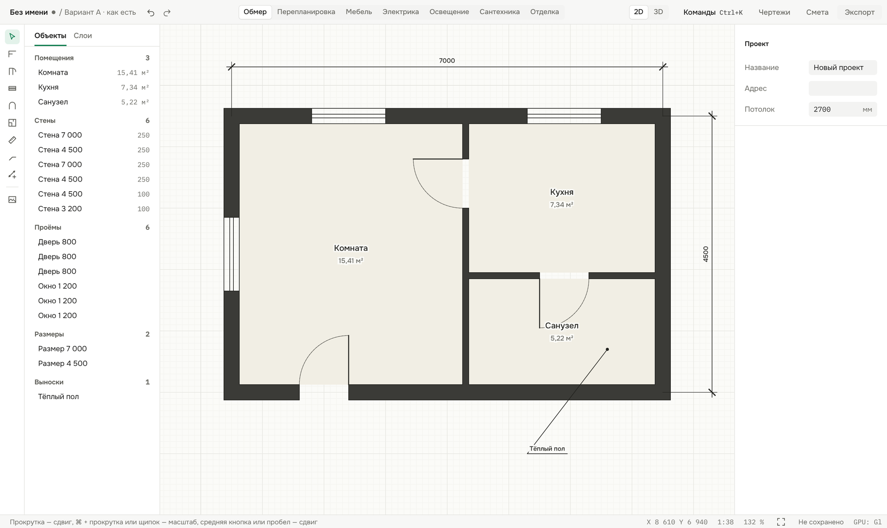
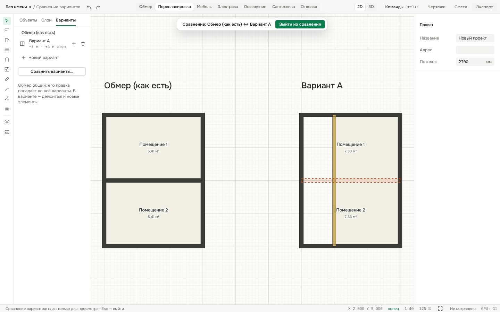
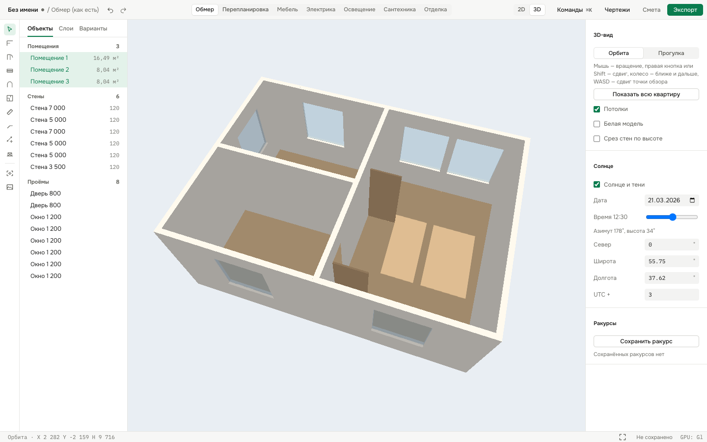
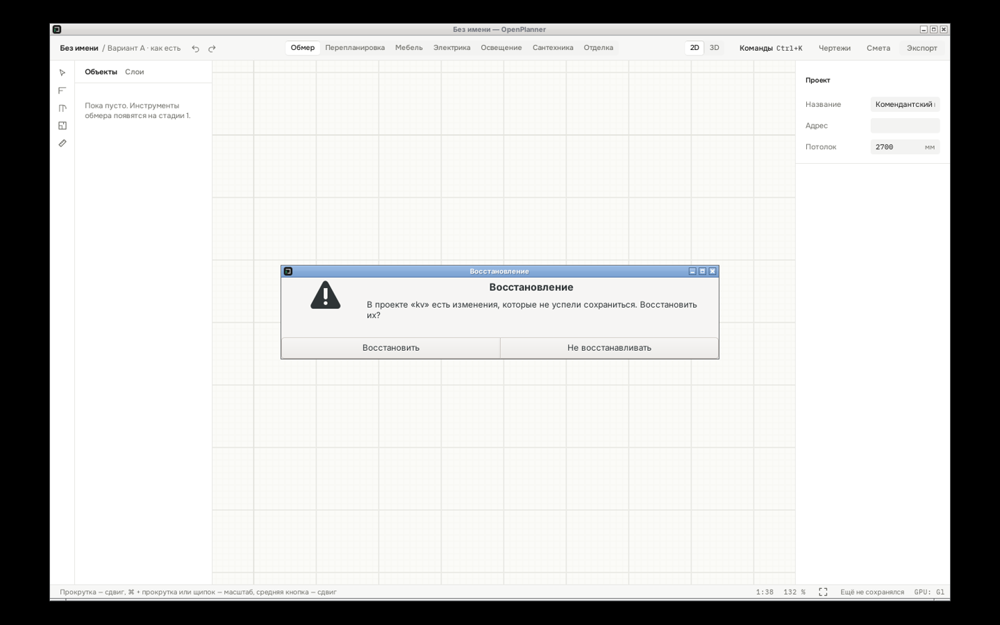

<div align="center">

# 📐 OpenPlanner

**An open-source desktop planner for apartment renovation — from a tape measure (or a LiDAR scan) to a complete set of working drawings and a cost estimate.**

[](https://github.com/kewldan/OpenPlanner/actions/workflows/ci.yml)




</div>

---

Most room planners stop at a pretty 3D picture. OpenPlanner is built around what a renovation crew actually needs: **one model of the apartment** that turns into themed drawing sheets — survey, demolition, new partitions, furniture, electrical, plumbing, finishes — plus an estimate whose quantities come straight from the model. Exporting your own project will never be paywalled. 🆓

> 🚧 **Status: Stages 0–10 are complete.** Measure the apartment by hand or import a LiDAR scan, sketch replanning variants on top of the survey, furnish it from the catalog or your own GLB models, place outlets, switches and lights with panel groups and load calculations, lay out water and drain outlets with pipe routing and slope checks, finish floors, walls and ceilings with tile layouts and material quantities, price it all with an estimate whose quantities follow the model, get the working drawings (survey, demolition, partitions, rooms, furniture layout, electrical, plumbing, floor and ceiling plans, wall elevations) as PDF, DXF, SVG, PNG or XLSX, and walk through the result in 3D with real sunlight. Next up: extensions — photoreal render, IFC, web version (Stage 11). See the [roadmap](#-roadmap).

## ✨ Highlights

|                                      |                                                                                                                                                                                                                                                                                                                                                                                                                                                                                                                                             |
| ------------------------------------ | ------------------------------------------------------------------------------------------------------------------------------------------------------------------------------------------------------------------------------------------------------------------------------------------------------------------------------------------------------------------------------------------------------------------------------------------------------------------------------------------------------------------------------------------- |
| 📡 **Scan to plan**                  | Drop in a LiDAR scan — Polycam GLB, OBJ, PLY, ZIP or Apple RoomPlan room data. OpenPlanner finds the floor, ceiling, walls (with measured thickness where both faces were scanned), doors and windows, asks about doubtful spots with a confidence score, and imports the plan with room areas as a single undoable step. Recognition runs locally, in a background worker.                                                                                                                                                                 |
| 🧱 **Replanning variants**           | The survey stays the single “as is” plan; each variant marks what to demolish and adds new partitions with a material (aerated concrete, drywall, brick). A survey edit shows up in every variant at once. Compare two variants by room areas, demolished and new wall lengths and areas, or side by side on the plan.                                                                                                                                                                                                                      |
| 🗂️ **Drawings from the model**       | The survey, demolition, partition and room plans and the wall elevations are built from the same model, the plans at one scale, with a ГОСТ title block, room schedule, demolition and partition statements and a legend. Export a vector PDF with layers and searchable Cyrillic text, DXF by layers, SVG, PNG, XLSX — or a single “crew pack” ZIP.                                                                                                                                                                                        |
| 🛋️ **Furniture that snaps to walls** | Pick from a searchable catalog (bedroom, living room, kitchen, bathroom, storage, workplace) or drop in your own GLB model. Click or drag items onto the plan — near a wall they turn their back to it. Rotate, mirror and resize; furniture shows up in 3D, on wall elevations and on a furniture layout sheet with a specification.                                                                                                                                                                                                       |
| ⚡ **Electrical that adds up**       | Place outlets, switches and lights from a catalog; wall points snap to the wall face at their mounting height. Link switch keys to lights, save lighting scenes, and let OpenPlanner split points into panel groups: breaker, RCD, cable size, run length along the walls, load and voltage drop with warnings, the panel’s DIN modules and enclosure, and room illuminance against the norms. Four electrical sheets come out of the same model.                                                                                           |
| 🚿 **Plumbing with slope checks**    | Put a bathtub, sink or toilet on the plan and get its cold, hot and drain outlets at standard heights; add risers and manifolds, route pipes automatically or draw them by hand. OpenPlanner checks drain slopes against the minimum for the pipe size, drain levels against the riser inlet and access to the riser cleanout, and counts pipes in sticks, elbows, tees and fittings. Water supply and drainage sheets come out of the same model.                                                                                          |
| 🧱 **Finishes with tile layout**     | Assign tiles, laminate, paint, wallpaper or a stretch ceiling to a room's floor, ceiling, walls or a single wall band (an apron up to 1.5 m, say). Areas are net of openings; tiles are laid out straight, staggered or diagonal with joints, narrow cuts are flagged and the start point can be optimised. Quantities come in pieces and packs, with adhesive and grout. Floor and ceiling plans and the wall elevations show the layout.                                                                                                  |
| 💰 **Estimate from the model**       | Start from a template price list or import your own from CSV or Excel. Each item takes its quantity from the model — floor, wall and ceiling areas, demolished and new walls, outlets and lights, cable runs, pipes, fixtures, finish areas and tile, adhesive and grout quantities — times a consumption rate plus reserve, so the estimate updates with every edit. Override any line by hand, group by section or by room, get a purchase list, keep price history, compare the cost of replanning variants, and export to Excel or CSV. |
| 🧊 **3D with real sunlight**         | Switch the plan to 3D: orbit around the apartment or walk through it with WASD, cut the walls at any height, hide ceilings, show a white model or material colours, and save camera views in the project. Set the date, time and the plan’s orientation to north — the sun casts real shadows through your windows.                                                                                                                                                                                                                         |
| 📏 **Survey tools**                  | Wall chains with snapping (ends, midpoints, perpendicular, axes, grid) or exact lengths and angles from the keyboard, mitered corners and T-junctions, doors / windows / arches, node-anchored dimensions, leaders, layers you can hide or lock, and an image underlay you calibrate with one known distance.                                                                                                                                                                                                                               |
| 📐 **Rooms that compute themselves** | Click inside a closed contour (or let _Find rooms_ do it): area and perimeter are measured along the wall faces and stay correct when you move, split or extend walls.                                                                                                                                                                                                                                                                                                                                                                      |
| 🦀 **Rust core, GPU canvas**         | The document model and the renderer are Rust compiled to WebAssembly and run in a Web Worker. The plan is drawn with **wgpu** — WebGPU where the platform provides it, WebGL2 otherwise — so the UI thread stays responsive.                                                                                                                                                                                                                                                                                                                |
| 🖥️ **Native desktop app**            | Built on **Tauri 2**: small binaries, native file dialogs, real `.oplan` files on disk. macOS is the primary target; Windows and Linux are first-class in CI.                                                                                                                                                                                                                                                                                                                                                                               |
| 🛟 **Crash-proof by design**         | Every edit is appended to a journal next to your file. Kill the process, pull the plug — on the next open OpenPlanner offers to restore your changes, undo history included. Projects with a file are also autosaved every 30 s.                                                                                                                                                                                                                                                                                                            |
| 💾 **Open file format**              | `.oplan` is a plain ZIP with a JSON model, a published [JSON Schema](schema/) and versioned migrations. The format crate and schema are **MIT-licensed**, so other tools can read and write projects freely.                                                                                                                                                                                                                                                                                                                                |
| ⌨️ **Keyboard-first**                | A command palette (<kbd>⌘K</kbd>), a shortcut cheat sheet (<kbd>⌘/</kbd>), and shortcuts that work in any keyboard layout.                                                                                                                                                                                                                                                                                                                                                                                                                  |
| ↩️ **Real undo**                     | Every change is a reversible command in the Rust core. The “unsaved” marker is tracked precisely — undo back to the saved state and it clears.                                                                                                                                                                                                                                                                                                                                                                                              |
| 🌗 **Dense, calm UI**                | A compact Figma/Linear-style interface with light and dark themes. The drawing canvas always stays paper-white.                                                                                                                                                                                                                                                                                                                                                                                                                             |
| 🧪 **Tested on real windows**        | CI launches the actual desktop app on macOS, Windows and Linux, drives the **native** Save/Open dialogs, kills the process and verifies recovery, and checks rendered pixels on Metal, D3D12 and Vulkan.                                                                                                                                                                                                                                                                                                                                    |

<p align="center">
  <br>
  <sub>Survey and “Variant A” side by side: the demolished partition is dashed red, the new drywall partition is drawn in its material colour.</sub>
</p>

<p align="center">
  <br>
  <sub>3D view at noon on the equinox in Moscow: sunlight from the south windows falls on the floor, everything else is lit by the sky.</sub>
</p>

<p align="center">
  <br>
  <sub>After <code>kill -9</code>: the native prompt offers to restore the edits from the journal.</sub>
</p>

## 🗺️ Roadmap

Development goes in stages. Each stage ships fully working; there is no throwaway MVP.

| Stage                     | Scope                                                                                                 | Status     |
| ------------------------- | ----------------------------------------------------------------------------------------------------- | ---------- |
| 0 · Foundation            | App shell, engine, `.oplan` files, autosave and recovery, command palette, CI on 3 OSes               | ✅ Done    |
| 1 · Survey                | Walls with snapping and numeric input, openings, rooms with areas, dimensions, layers, image underlay | ✅ Done    |
| 2 · Scan                  | Import a Polycam LiDAR scan → walls, openings and rooms, with a review step                           | ✅ Done    |
| 3 · Replanning            | Existing / demolish / new status, partitions, design variants and comparison                          | ✅ Done    |
| 4 · Drawings              | Sheet set with title block, wall elevations, vector PDF, DXF by layers                                | ✅ Done    |
| 5 · 3D                    | Orbit, walkthrough, saved views, section cut, sun and shadows                                         | ✅ Done    |
| 6 · Furniture             | Catalog, drag and drop, wall snapping, GLB import, furniture layout sheet                             | ✅ Done    |
| 7 · Electrical & lighting | Outlets, switches, panel groups, cable runs, illuminance                                              | ✅ Done    |
| 8 · Plumbing              | Fixtures, outlets, auto-routing, slope checks                                                         | ✅ Done    |
| 9 · Finishes              | Surfaces, tile layout with cuts, wall elevations                                                      | ✅ Done    |
| 10 · Estimate             | Quantities from the model, price lists, XLSX                                                          | ✅ Done    |
| 11 · Extensions           | Photoreal render, IFC, web version, floors, sync                                                      | 📋 Planned |

Full details: [product spec](docs/product-spec.md) (in Russian).

## 🏗️ How it fits together

```
┌──────────────────────────── WebView (WKWebView · WebView2 · WebKitGTK) ────────────────────────────┐
│  UI thread: React + TypeScript              Web Worker: op-engine (Rust → WASM)                     │
│  panels, inspector, ⌘K palette    ──cmds──▶ document model · commands · undo · autosave journal     │
│  Zustand projections of the model ◀─events─ wgpu renderer: plan + 3D (WebGPU | WebGL2) → canvas     │
│                                             drawing sheets → PDF · SVG · DXF · XLSX                 │
└───────────────────────────────────────────────┬─────────────────────────────────────────────────────┘
                                                │ Tauri IPC
┌───────────────────────────────────────────────┴─────────────────────────────────────────────────────┐
│  Tauri 2 (native Rust): file system, atomic .oplan and export writes, journals, native dialogs      │
└─────────────────────────────────────────────────────────────────────────────────────────────────────┘
```

- The **Rust core is the source of truth.** The UI sends commands and renders projections.
- **TypeScript types are generated from Rust** (tsify), so the protocol can't drift.
- The same crates compile to **WASM** (worker, future web version) and **native** (Tauri, tests).

More in [architecture](docs/architecture.md) and the [decision log](docs/decisions.md) (both in Russian).

## 🧪 Try a build

Every CI run publishes the desktop app as an artifact: open a green run on the [Actions page](https://github.com/kewldan/OpenPlanner/actions/workflows/ci.yml) and download **OpenPlanner-macOS** (Apple Silicon `.app`), **OpenPlanner-Windows** (`.exe`, needs WebView2 — built into Windows 10/11) or **OpenPlanner-Linux** (binary, needs WebKitGTK 4.1).

The macOS build is not notarised yet. After unzipping, either right-click the app → **Open**, or run:

```bash
xattr -dr com.apple.quarantine OpenPlanner.app
```

## 🚀 Getting started

**Prerequisites**

- 🦀 Rust — the toolchain is pinned in `rust-toolchain.toml` (includes `wasm32-unknown-unknown`)
- 🥟 [Bun](https://bun.com) 1.4+
- 🔧 `wasm-bindgen-cli`, matching the `wasm-bindgen` version in `Cargo.toml`:

  ```bash
  cargo install wasm-bindgen-cli --version 0.2.130 --locked
  ```

- 🧩 Tauri system dependencies for your OS: <https://v2.tauri.app/start/prerequisites/>

**Run**

```bash
bun install
```

```bash
bun run build:wasm
```

```bash
bun run dev
```

`bun run dev` opens the desktop app. For the browser build only, use `bun run dev:web` (<http://localhost:1420>). Rebuild the engine with `bun run build:wasm` after changing Rust crates it depends on.

## 🧪 Testing

| What                                        | Command                                                                                                         |
| ------------------------------------------- | --------------------------------------------------------------------------------------------------------------- |
| 🦀 Rust: format, lints, tests               | `cargo fmt --all -- --check && cargo clippy --workspace --all-targets -- -D warnings && cargo test --workspace` |
| 🟦 TypeScript: lint, types, unit tests      | `bunx biome check . && bunx tsc -b && bun test`                                                                 |
| 🦀 Engine scenarios (pointer + keyboard)    | `cargo test -p op-engine`                                                                                       |
| 🖼️ GPU frames: plan and 3D sun shadows      | `OPENPLANNER_REQUIRE_GPU=1 cargo test -p op-render`                                                             |
| 🌐 E2E on the web build (WebGL2 + WebGPU)   | `cd apps/desktop && bunx vite build && bunx playwright test`                                                    |
| 🖥️ E2E on the real Linux desktop window     | `bash scripts/desktop-e2e.sh` (needs a built app, Xvfb, openbox, xdotool, `tauri-driver`)                       |
| 🗂️ Native dialogs + crash recovery (any OS) | `bash scripts/desktop-dialogs.sh <path to app binary>`                                                          |

CI runs all of the above on every push, plus a selftest of the packaged app on **macOS 26, Windows and Linux** and an offscreen render check on **Metal, D3D12 and Vulkan**.

## 📁 Repository layout

```
apps/desktop/          Tauri 2 app (src-tauri) + Vite entry, e2e tests
packages/ui/           design tokens and base components (CSS Modules, Base UI)
packages/editor/       the editor: shell, inspector, canvas, commands, project files
packages/engine-client/  worker + typed client for the WASM engine
crates/op-model/       document, commands, undo/redo, journal ops
crates/op-geom/        geometry: wall joints, unions, room regions
crates/op-render/      wgpu renderer: plan, 3D with sun shadows (+ offscreen rendering for tests)
crates/op-engine/      WASM engine: model, tools, drawing sheets, 3D mesh + renderer in the worker
crates/op-format/      .oplan read/write, migrations, journal          (MIT)
crates/op-scan/        LiDAR scan readers and recognition
crates/op-export/      drawing sheets: PDF, SVG, DXF, XLSX (IFC later)
crates/op-calc/        engineering calculations and estimates          (stages 7–10)
schema/                JSON Schema of the file format                  (MIT)
scripts/               WASM build, desktop selftests and drivers
docs/                  product spec, architecture, decision log
```

## 🛠️ Tech stack

**Tauri 2** · **React 19** + **TypeScript** · **Rust** + **wgpu** (WebGPU / WebGL2) · **wasm-bindgen** + **tsify** · **Zustand** · **Base UI** · **CSS Modules** · **Bun** + **Vite** · **Biome** · **Playwright** · **Lefthook**

## 🤝 Contributing

Contributions are welcome — please read [CONTRIBUTING.md](CONTRIBUTING.md) first. In short:

- 🧼 **Clean room.** OpenPlanner reimplements _behaviour_, never code, text, icons or assets of proprietary planners. No decompiling or scraping of other products.
- ✍️ Commits follow [Conventional Commits](https://www.conventionalcommits.org/) and are signed off (DCO).
- 🧭 Key architectural decisions are recorded in [`docs/decisions.md`](docs/decisions.md) before they are implemented.

## 📄 License

- The application is licensed under **[AGPL-3.0](LICENSE)**.
- The project file format — [`crates/op-format`](crates/op-format) and [`schema/`](schema) — is licensed under **MIT**, so any tool can read and write `.oplan` files.
